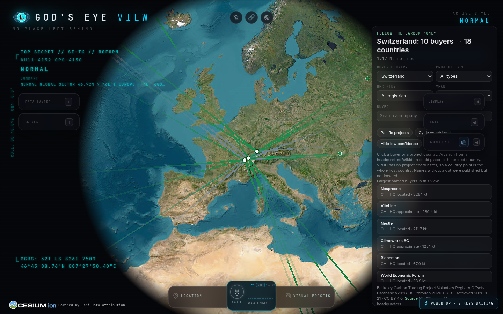
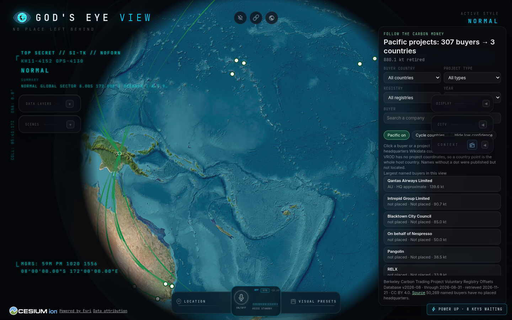

# Follow the carbon money

Animated arcs from the organizations that retire carbon credits to the countries of the projects those credits came from. This is a layer on God's Eye View for Clint Borle / CORA Global Projects. The application's MIT license is unchanged and covers the code only. The dataset is not MIT.

## What you are looking at

Each arc starts at a buyer's headquarters (or, when that is all the registries published, the buyer's country) and ends at the **country** of a project whose credits that buyer retired. One arc is one buyer–country pair. Tonnes are retired credits, and one credit is one metric tonne of CO₂-equivalent, as Berkeley records it.

Click a buyer dot for the projects, tonnes, and retirement years. Click a green country dot for the projects hosted there, then a project for the buyers.

The caption follows Bernat Fortet's "Follow the carbon money" map: `Switzerland: 10 buyers → 18 countries`. With no country selected, the globe cycles the largest buyer countries. **Pacific projects** limits the map to credits from Pacific island host countries.







## Setup

The layer needs no API key. Google 3D Tiles (`GOOGLE_MAPS_API_KEY`) and Cesium ion (`CESIUM_ION_TOKEN`) stay optional, as in the root [`.env.example`](../../../../.env.example). With neither key the globe uses keyless Esri imagery and the arcs still draw.

```bash
npm ci
npm run dev
```

Open the app, then turn on **Carbon Flows** in the data layers panel. Voice phrases that enable it: "carbon", "carbon credits", "follow the carbon money".

The shipped file is `carbon-flows.json` next to this README. You do not need to rebuild it to run the app.

## Data refresh

Source, both CC BY 4.0, data through 31 August 2026, version **v2026-08**:

- Projects workbook: <https://gspp.berkeley.edu/assets/uploads/page/Voluntary-Registry-Offsets-Database--v2026-08.xlsx>
- Registry retirement files: <https://gspp.berkeley.edu/assets/uploads/page/VROD-registry-files--2026-08.xlsx>
- Dataset page and citation: <https://gspp.berkeley.edu/berkeley-carbon-trading-project/offsets-database>

```bash
python3 -m pip install -r scripts/carbon/requirements.txt
npm run carbon:build
```

The script caches the workbooks, Natural Earth 50m admin-0 countries, and GeoNames cities5000 under `.gev-cache/carbon/` (gitignored). Wikidata headquarters lookups are cached in `scripts/carbon/hq-cache.json` (committed) so a later run does not invent a new coordinate for a name already resolved, and does not retry a recorded miss into a different guess. Delete a cache key only when you intend to look that name up again.

Cite the database if you redistribute the JSON:

> Pamela Quartson, Barbara K Haya, Tyler Bernard, Aline Abayo, Xinyun Rong, Ivy S So, Micah Elias. (2026). Voluntary Registry Offsets Database v2026-08, Berkeley Carbon Trading Project, University of California, Berkeley. Retrieved from https://gspp.berkeley.edu/berkeley-carbon-trading-project/offsets-database

Also attribute GeoNames (CC BY 4.0) for buyer cities, Wikidata for headquarters, and Natural Earth (public domain) for country label points. The in-app attribution popover carries the same credit.

This build (retrieved 2026-11-21, retirements through 2026-08-31): 499,789 retirement rows, 208,573 joined to a named buyer and a located project, 535 buyers placed on the globe, 50,269 named buyers left unplaced, 1,611 projects, 4,302 buyer–project flows. Verra rows with a blank beneficial owner: 137,420 rows and about 463 million tonnes, omitted rather than assigned. Pacific host countries present: Papua New Guinea (4 projects), Fiji (1), New Caledonia (1). The same figures are in `carbon-flows.json` → `meta.counts`.

## How a buyer is located

Confidence is stored on each buyer as `conf` and drawn on the globe (amber dots and arcs are low confidence).

| `conf` | `method` | Meaning |
|---|---|---|
| `high` | `geonames-city` | The registry named the account holder's city and country, and that city is unique in GeoNames cities5000 (or the state code picked one city). **v2026-08 left the ACR/ART city and country columns empty, so this build has no GeoNames matches.** |
| `medium` | `geonames-city` | Several cities shared the name. The most populous candidate was used. |
| `high` | `wikidata-hq` | One Wikidata item matched the published name and has a headquarters coordinate (P159). This is how every placed buyer in the shipped file was located. |
| `medium` | `wikidata-coord` | A coordinate that is not a headquarters statement. |
| `medium` | `wikidata-search` | The shortened name matched a different Wikidata item, and a search for the full published name returned another organization. The search result is used. |
| `low` | `registry-country-centroid` | The registry named a country and no city or Wikidata headquarters was accepted. Drawn for buyers of at least 5,000 tonnes, and for any buyer of Pacific credits. The dot is the country label point. |
| `unplaced` | (none) | A name was published, but neither a city nor a single Wikidata hit nor a country was available. No arc. Pacific buyers in this state are still listed in the panel. |

A registry city is kept even when Wikidata has a different item with the same name. Several Wikidata hits with no country to separate them are a miss, not a guess.

## Known gaps

These are omissions, not fills.

- **Verra beneficial owner is often blank.** Those retirements are counted in `meta.counts.verraBlankBeneficiaryRows` / `verraBlankBeneficiaryTonnes` and are not assigned to anyone. Verra's retirement-reason text is not parsed.
- **Gold Standard notes are not parsed.** Only the `Using Entity` column is the buyer. A note that names a different company stays unused.
- **Cancellations, buffer-pool moves, and California / Quebec / Washington compliance totals are excluded.** Those tables do not name a voluntary beneficiary this build can attribute.
- **No project coordinates.** VROD has a country and a site description. Arcs end at the Natural Earth country label point. A site string is shown on the project card and is not geocoded. Same-country flows draw a short loop at that label point so the retirement stays visible.
- **Buyer names are grouped** by a normalized form with legal suffixes (`Inc`, `Ltd`, `GmbH`, …) removed. Two different organizations that share that form can be merged. Account numbers and names with fewer than three letters are dropped.
- **Wikidata is not exhaustive.** Buyers under 5,000 tonnes are not looked up unless they retired Pacific credits or the registry already gave a city. A headquarters coordinate can be a campus or a loosely labeled place; it is still the published Wikidata statement, flagged by the method above.
- **Pacific preset** is Pacific Islands Forum island members plus American Samoa, Guam, the Northern Mariana Islands, Tokelau, and Wallis and Futuna. Australia and New Zealand are excluded on purpose: the preset is "who buys credits from Pacific island projects". Countries in that list with no project in v2026-08 simply do not appear. The host countries that do appear are `meta.counts.pacificProjectCountries`.
- **Nature-based types** follow VROD's harmonized `Type` column: REDD+ (including jurisdictional REDD+ and avoided forest conversion), ARR, IFM, wetland restoration (VROD does not split mangroves out of this type), soil (sustainable agriculture, grassland, rice, nitrogen, irrigation, compost), and biochar (including biomass carbon removal and storage). Everything else is `other`, including cookstoves and renewable energy.
- **Not the 296-company map.** Fortet's LinkedIn post is the visual model. This layer does not reproduce that headcount. The buyer count is whatever the retirement tables name.

## Files

| Path | Role |
|---|---|
| `carbon-flows.json` | Derived dataset the globe loads |
| `scripts/carbon/build_carbon_flows.py` | Download and rebuild |
| `scripts/carbon/hq-cache.json` | Wikidata lookup cache |
| `scripts/carbon/requirements.txt` | Python build dependency (`python-calamine`) |
| `src/data/carbonFlows.js` | Cesium layer |
| `src/data/carbonFlowsModel.js` | Filters, captions, click-through records |
