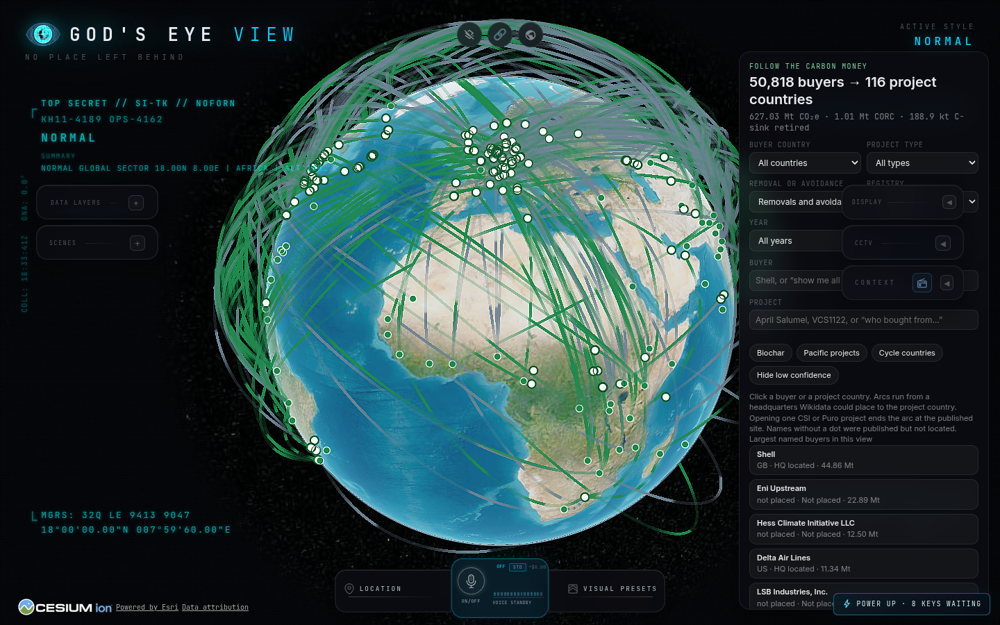
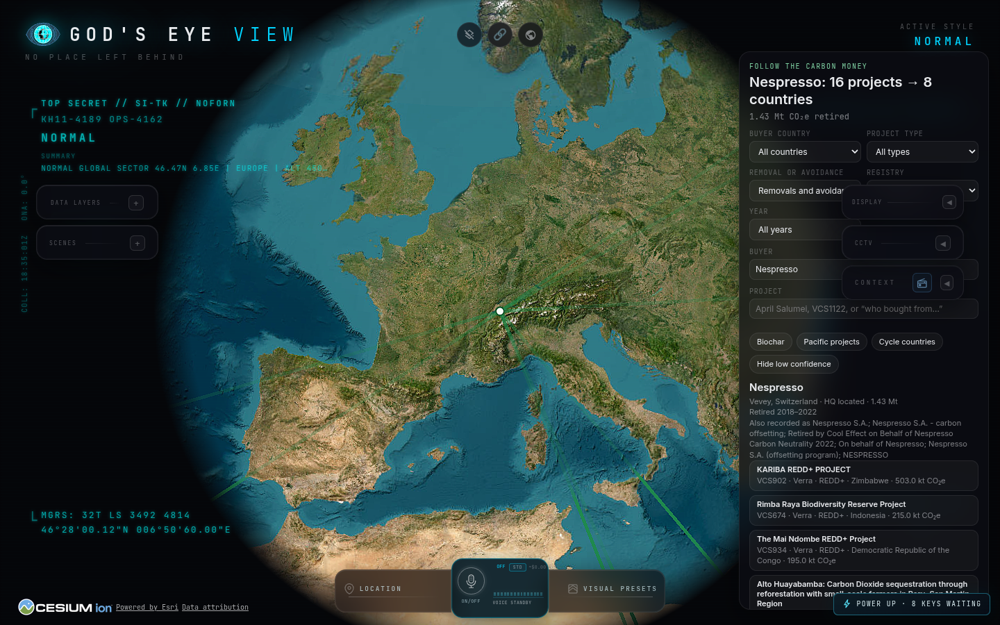
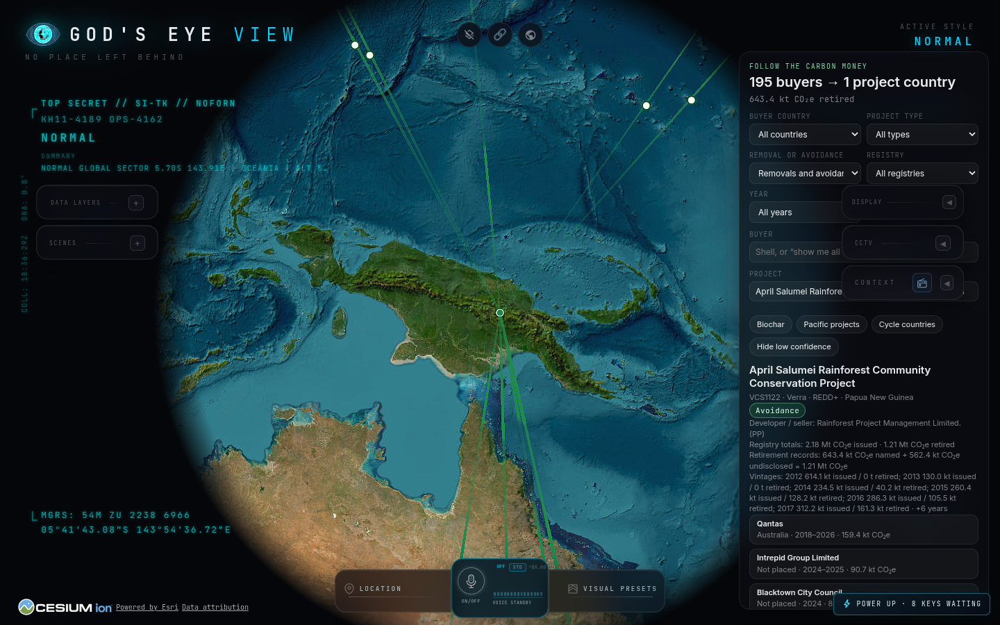
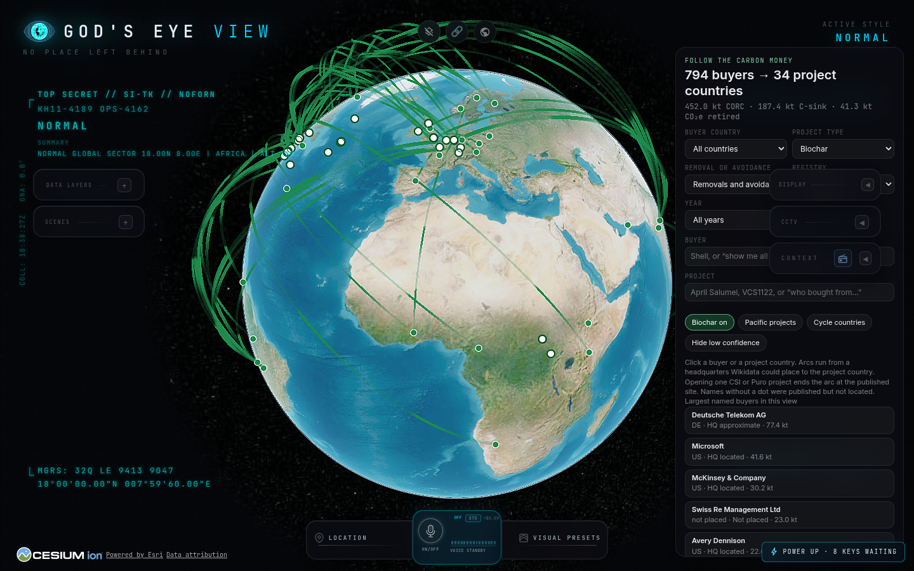
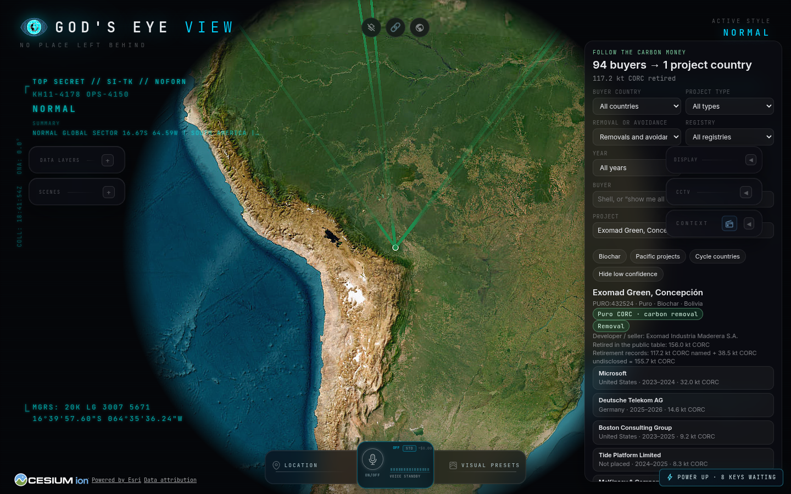
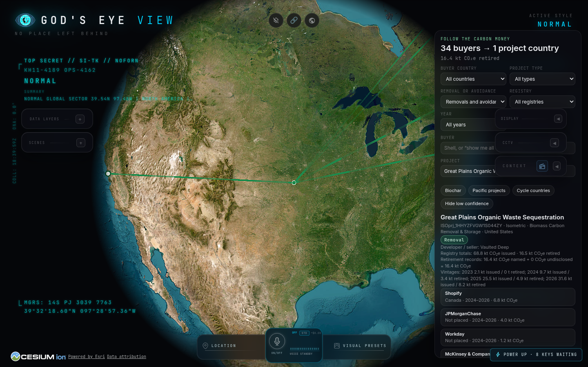
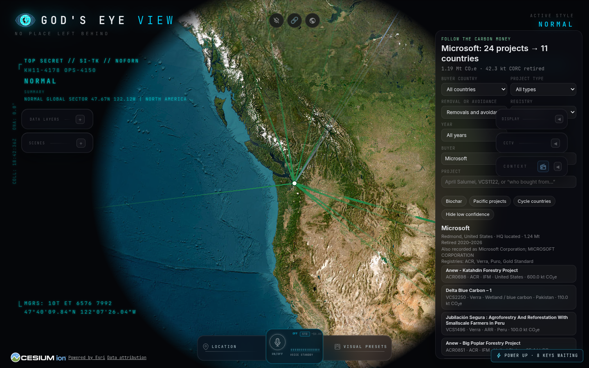

# Follow the carbon money

Animated arcs from the organizations that retire carbon credits to the countries of the projects those credits came from. This is a layer on God's Eye View for Clint Borle / CORA Global Projects. The application's MIT license is unchanged and covers the code only. The dataset is not MIT.

## What you are looking at

Each arc starts at a buyer's headquarters (or, when that is all the registries published, the buyer's country) and ends at the **country** of a project whose credits that buyer retired. Opening one CSI or Puro project that published a site ends that arc at the site. One arc is one buyer–country pair, except that single-project view. Berkeley VROD tonnes are metric tonnes of CO₂-equivalent. CSI quantities are time-dependent C-sinks and Puro quantities are CORCs. The caption keeps those units separate.

Search **Buyer** (`Shell`, or `show me all Shell credits`) to list every project that buyer retired and draw arcs from its headquarters. Search **Project** (`April Salumei`, `VCS1122`, or `who bought from April Salumei`) for the seller, registry totals, vintages, every named buyer, and the undisclosed tonnes. The buyer panel lists the raw registry strings merged into that name.

The app already has a voice agent (`GEV_REALTIME_TOOLS` in `vite.config.js`, handled in `src/voice/gevActions.js`). Those same phrases call `lookup_carbon`, which uses `resolveCarbonQuery`. No second voice stack was added.

The caption follows Bernat Fortet's "Follow the carbon money" map: `Switzerland: 10 buyers → 18 countries`. With no country selected, the globe cycles the largest buyer countries. **Pacific projects** limits the map to credits from Pacific island host countries. **Biochar** is a one-click type filter across VROD, CSI, and Puro. **Removal or avoidance** uses VROD's Reduction / Removal column, and marks every CSI and Puro credit as a removal.


















## Setup

The layer needs no API key. Google 3D Tiles (`GOOGLE_MAPS_API_KEY`) and Cesium ion (`CESIUM_ION_TOKEN`) stay optional, as in the root [`.env.example`](../../../../.env.example). With neither key the globe uses keyless Esri imagery and the arcs still draw.

```bash
npm ci
npm run dev
```

Open the app, then turn on **Carbon Flows** in the data layers panel. Voice phrases that enable it: "carbon", "carbon credits", "follow the carbon money".

The shipped file is `carbon-flows.json` next to this README. You do not need to rebuild it to run the app.

## Data refresh

Source, both CC BY 4.0, data through 31 August 2026, version **v2026-08**:

- Projects workbook: <https://gspp.berkeley.edu/assets/uploads/page/Voluntary-Registry-Offsets-Database--v2026-08.xlsx>
- Registry retirement files: <https://gspp.berkeley.edu/assets/uploads/page/VROD-registry-files--2026-08.xlsx>
- Dataset page and citation: <https://gspp.berkeley.edu/berkeley-carbon-trading-project/offsets-database>

```bash
python3 -m pip install -r scripts/carbon/requirements.txt
npm run carbon:build
```

The script caches the workbooks, Natural Earth 50m admin-0 countries, and GeoNames cities5000 under `.gev-cache/carbon/` (gitignored). Wikidata headquarters lookups are cached in `scripts/carbon/hq-cache.json` (committed) so a later run does not invent a new coordinate for a name already resolved, and does not retry a recorded miss into a different guess. Delete a cache key only when you intend to look that name up again.

Cite the database if you redistribute the JSON:

> Pamela Quartson, Barbara K Haya, Tyler Bernard, Aline Abayo, Xinyun Rong, Ivy S So, Micah Elias. (2026). Voluntary Registry Offsets Database v2026-08, Berkeley Carbon Trading Project, University of California, Berkeley. Retrieved from https://gspp.berkeley.edu/berkeley-carbon-trading-project/offsets-database

Also attribute GeoNames (CC BY 4.0) for buyer cities, Wikidata for headquarters, and Natural Earth (public domain) for country label points. The in-app attribution popover carries the same credit.

`npm run carbon:build` also refreshes two public removal registries and writes a dated snapshot under `.gev-cache/carbon/snapshots/` (gitignored). `npm run carbon:build:csi` fetches only the CSI snapshot.

### Carbon Standards International

Public site: <https://global-c-registry.org/>. The registry page is the public record. The C-Sink Tool is password-protected and was not used, and neither was the bearer-token import API in its OpenAPI document.

The build calls the unauthenticated GET endpoints the logged-out registry already calls:

- `https://global-c-sink.easy-cert.cloud/v1/projects/public-projects/`
- `https://global-c-sink.easy-cert.cloud/v1/products/batch-list/`

`robots.txt` on both hosts returns the site shell rather than crawl rules. Requests use a descriptive user agent and a short pause between pages. Projects keep the published latitude and longitude, the company name as the seller, and the standard as the methodology. A batch with a beneficiary and no remaining quantity is a retirement. A batch that moved quantity with no beneficiary is an undisclosed retirement. The unit is `c-sink`, drawn separately from tCO₂e, because these are time-dependent C-sinks.

### Puro.earth

Public pages: <https://registry.puro.earth/projects> and <https://registry.puro.earth/retirements>. Those pages embed the project and retirement tables a logged-out visitor receives. The role-based Registry API (`docs.api.puro.earth`) was not called. `robots.txt` on the registry host is a 404. The supplier is the seller. Methodology codes map to biochar, wooden building elements, geologically stored carbon, enhanced rock weathering, terrestrial biomass storage, carbonated materials, and soil amendment. The unit is `corc`. A retirement with a hidden beneficiary is undisclosed. Puro says beneficiary publication can be delayed.

### Other ICROA programmes and ratings

Programmes already inside VROD (Verra, Gold Standard, ACR, CAR, ART TREES, Isometric retirements) are not fetched again. The rest of the programmes named for this pass, and the ratings agencies, are in `meta.skippedSources` with the reason. Short version:

| Source | Why it is not a new feed |
|---|---|
| Isometric Registry | `api.isometric.com` returns 401 without `X-Client-Secret`. The public projects page does not embed the ledger. VROD registry `ISO` stays. |
| ART TREES | Already in VROD as registry `ART`. |
| Plan Vivo | No public project-and-retirement bulk feed. The Markit viewer is login-gated. |
| Cercarbono | Public EcoRegistry search is an interactive viewer without an unauthenticated retirement export. |
| Riverse | Public catalogue, no retirement ledger with beneficiaries. |
| Social Carbon | No public bulk retirement feed. SOCIALCARBON issued through Verra is already in VROD. |
| BeZero | The public listings table is marked as illustrative fictitious samples. The ratings API requires OAuth. Nothing was copied. |
| Sylvera | Paid catalogue. No free public ratings list. |
| Calyx Global | Ratings sit behind the Calyx platform. |
| MSCI Carbon Markets | No free public project-ratings feed. |

No ratings badge is shown, because none of those agencies published a free list this build could copy without a paywall or a login. A badge appears only when a project record carries `rating: {source, rating, date}`.

This build (retrieved 2026-11-21, VROD retirements through 2026-08-31): 499,789 VROD retirement rows. `meta.counts` records 211,739 named retirement rows (VROD plus CSI and Puro) and 246,349 VROD rows with a blank beneficiary kept as undisclosed tonnes (about 586 million). The file holds 12,135 projects (149 CSI, 130 Puro, 71 Isometric already in VROD), 50,818 merged buyers, and 78,509 buyer–project flows. CSI snapshot: 149 projects and 6,332 of 6,345 public batches (13 batch offsets returned HTTP 500 from the public list and were skipped, not guessed). Puro snapshot: 130 projects and 1,646 retirement transactions. All 149 CSI projects have a published coordinate; 44 Puro projects do. Verra blank beneficial-owner rows: 137,420 (about 463 million tonnes). Pacific host countries in the project table: Papua New Guinea (22), Fiji (2), Solomon Islands (1), New Caledonia (1), Guam (1). Pacific **removal** projects in that set: CSI `GCSP1056` Pacific Island Food Forest Project – PNG (biochar), Gold Standard Markham Valley and Morobe Markham (ARR, Papua New Guinea), the Isometric Morobe Markham Reforestation project, and the University of Guam sustainable reforestation project. The same figures are in `carbon-flows.json` → `meta.counts`. Microsoft is one buyer across ACR, Gold Standard, Verra, and Puro.

## Buyer names

`scripts/carbon/build_carbon_flows.py` merges beneficiaries before geocoding:

1. Take the text after the last “on behalf of”, when that phrase is present.
2. Strip leading `retired on behalf of`, `on behalf of`, `retired by`, `retired for`, and `for`.
3. Drop legal suffixes (`Ltd`, `Limited`, `Pty`, `Inc`, `SA`, `AG`, `plc`, `SL`, `GmbH`, `LLC`, `Corp`, and the same list the script already used).
4. Fold case and punctuation.
5. Apply `buyer-aliases.json`. That file is the only hand-written name list. Keys are published names; values are the canonical buyer. The build normalises both sides, so adding `Qantas Airways Limited` → `Qantas` also catches `Qantas Airways Ltd`.

The panel keeps the published strings under “Also recorded as”. Programmes that are not the company (`Qantas Duty Travel`, `Qantas Fly Carbon Neutral Programme`) are not in the alias map and stay separate.

## How a buyer is located

Confidence is stored on each buyer as `conf` and drawn on the globe (amber dots and arcs are low confidence).

| `conf` | `method` | Meaning |
|---|---|---|
| `high` | `geonames-city` | The registry named the account holder's city and country, and that city is unique in GeoNames cities5000 (or the state code picked one city). **v2026-08 left the ACR/ART city and country columns empty, so this build has no GeoNames matches.** |
| `medium` | `geonames-city` | Several cities shared the name. The most populous candidate was used. |
| `high` | `wikidata-hq` | One Wikidata item matched the published name and has a headquarters coordinate (P159). This is how every placed buyer in the shipped file was located. |
| `medium` | `wikidata-coord` | A coordinate that is not a headquarters statement. |
| `medium` | `wikidata-search` | The shortened name matched a different Wikidata item, and a search for the full published name returned another organization. The search result is used. |
| `low` | `registry-country-centroid` | The registry named a country and no city or Wikidata headquarters was accepted. Drawn for buyers of at least 5,000 tonnes, and for any buyer of Pacific credits. The dot is the country label point. |
| `unplaced` | (none) | A name was published, but neither a city nor a single Wikidata hit nor a country was available. No arc. Pacific buyers in this state are still listed in the panel. |

A registry city is kept even when Wikidata has a different item with the same name. Several Wikidata hits with no country to separate them are a miss, not a guess.

## Known gaps

These are omissions, not fills.

- **Blank beneficiaries stay undisclosed.** They are summed on the project as “Undisclosed buyer” and are not given a company. Verra’s blank Beneficial Owner rows are `meta.counts.verraBlankBeneficiaryRows`. A project’s named tonnes plus undisclosed tonnes are the retirement rows this build read. The registry’s own issued and retired totals are shown beside that and can be higher, because cancellations and California / Quebec / Washington compliance retirements are not in these retirement sheets.
- **Gold Standard notes are not parsed.** Only the `Using Entity` column is the buyer. A note that names a different company stays unused.
- **Cancellations, buffer-pool moves, and California / Quebec / Washington compliance totals are excluded.** Those tables do not name a voluntary beneficiary this build can attribute.
- **VROD has no project coordinates.** It has a country and a site description. Those arcs end at the Natural Earth country label point. CSI and Puro arcs use a published latitude and longitude when you open that one project. Aggregated arcs still end at the country. A site string from VROD is shown on the project card and is not geocoded. Same-country flows draw a short loop at the label point so the retirement stays visible.
- **Buyer names are grouped** by a normalized form with legal suffixes (`Inc`, `Ltd`, `GmbH`, …) removed. Two different organizations that share that form can be merged. Account numbers and names with fewer than three letters are dropped.
- **Wikidata is not exhaustive.** Buyers under 5,000 tonnes are not looked up unless they retired Pacific credits or the registry already gave a city. A headquarters coordinate can be a campus or a loosely labeled place; it is still the published Wikidata statement, flagged by the method above.
- **Pacific preset** is Pacific Islands Forum island members plus American Samoa, Guam, the Northern Mariana Islands, Tokelau, and Wallis and Futuna. Australia and New Zealand are excluded on purpose: the preset is "who buys credits from Pacific island projects". Countries in that list with no project in v2026-08 simply do not appear. The host countries that do appear are `meta.counts.pacificProjectCountries`.
- **Nature-based types** follow VROD's harmonized `Type` column: REDD+ (including jurisdictional REDD+ and avoided forest conversion), ARR, IFM, wetland restoration (VROD does not split mangroves out of this type), soil (sustainable agriculture, grassland, rice, nitrogen, irrigation, compost), biochar (including biomass carbon removal and storage), and tree C-sinks. CSI artisan and biochar standards share the Biochar filter. Puro wooden building elements, geologic storage, enhanced weathering, biomass storage, and carbonated materials are removal types and are not folded into the nature-based chip. Everything else is `other`, including cookstoves and renewable energy.
- **Removal versus avoidance** is VROD's `Reduction / Removal` column (`Reduction` → avoidance, `Removal` or long-duration removal → removal, `Mixed` → mixed). CSI and Puro rows are removals. The filter does not turn a C-sink into a tCO₂e.
- **Not the 296-company map.** Fortet's LinkedIn post is the visual model. This layer does not reproduce that headcount. The buyer count is whatever the retirement tables name.

## Files

| Path | Role |
|---|---|
| `carbon-flows.json` | Derived dataset the globe loads |
| `scripts/carbon/build_carbon_flows.py` | Download VROD and rebuild, including CSI and Puro |
| `scripts/carbon/extra_sources.py` | Public CSI and Puro fetch. `npm run carbon:build:csi` snapshots CSI only |
| `scripts/carbon/hq-cache.json` | Wikidata lookup cache |
| `scripts/carbon/requirements.txt` | Python build dependency (`python-calamine`) |
| `src/data/carbonFlows.js` | Cesium layer |
| `src/data/carbonFlowsModel.js` | Filters, captions, click-through records |
